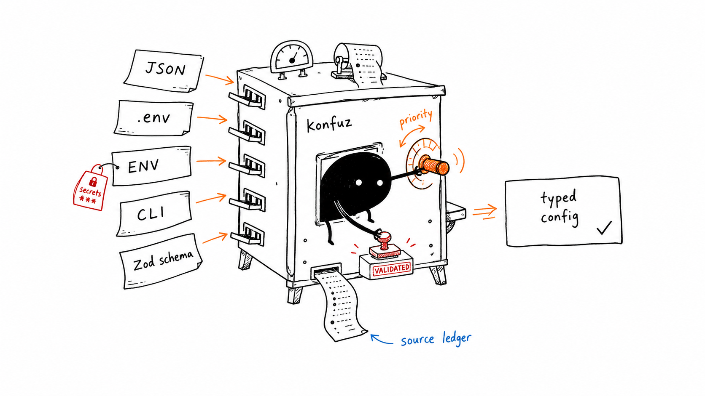

<h1 align="center">konfuz</h1>

<p align="center">
  <strong>One typed config from every source.</strong>
</p>

<p align="center">
  A zero-boilerplate Node.js library that reads JSON files, <code>.env</code> files, environment variables and CLI arguments into one object validated by Zod.
</p>

## Untangle the Config

Configuration ends up scattered across files, environment variables and command-line flags, each
parsed by hand. konfuz takes one Zod schema, derives the variable names and flags from its keys,
merges every source in a fixed priority order and returns a fully typed object.

## Features

- 🧩 Multi-source. Merges opt-in JSON files, `.env` files, environment variables and CLI arguments.
- 🥇 Fixed priority. CLI arguments override environment variables, explicit JSON files, `.env` files, default JSON files and Zod defaults.
- 🛡️ Type-safe. Define the config with Zod schemas and get automatic type inference.
- 🚩 Generated flags. Short (`-p`) and long (`--port`) CLI flags are created from the schema keys.
- ✏️ Custom names. `customConfigElement()` overrides the environment variable, CLI flag, short flag, description or JSON path of a field.
- 🙈 Secret masking. Fields marked `secret: true` are shown as `***` in error messages.
- 🔍 Source tracing. `printConfiguredSources()` prints a table of where each value came from.

## Use It

```typescript
import { configure } from 'konfuz';
import { z } from 'zod';

const config = configure({
  port: z.number().default(3000),
  host: z.string().default('localhost'),
  verbose: z.boolean(),
});

console.log(`Server running on ${config.host}:${config.port}`);
```

Values are merged in this order, highest priority first:

| Priority | Source | Example for `port` |
| --- | --- | --- |
| 1 | CLI arguments | `--port 8080` or `-p 8080` |
| 2 | Environment variables | `PORT=8080` |
| 3 | Explicit JSON file | `--config-file local.config` |
| 4 | `.env` file | `PORT=8080` in `.env` |
| 5 | Default JSON file | `options.configFile: 'konfuz.json'` |
| 6 | Zod defaults | `z.number().default(3000)` |

Schema keys become `UPPER_SNAKE_CASE` environment variables and `kebab-case` CLI flags. JSON files
are opt-in through `options.configFile`. Simple fields can use `'string'`, `'number'` or `'boolean'`
instead of a Zod schema.

- [Usage guide](https://github.com/victor141516/konfuz/blob/master/docs/usage.md): custom fields, JSON config files, `.env` paths, boolean flags, secrets, a full example.
- [API reference](https://github.com/victor141516/konfuz/blob/master/docs/api.md): `configure()`, `customConfigElement()`, `printConfiguredSources()`, `toEnvName()`, `toCliName()`.



## Install

```bash
npm install konfuz zod
# or
pnpm add konfuz zod
```

`zod` is a peer dependency (version 4 or later) and must be installed separately. konfuz targets
server-side Node.js 18+ and ships both ESM and CommonJS builds.

## Build

```bash
pnpm install
pnpm run build
```

The build uses tsdown and writes the ESM and CommonJS bundles with type declarations to `dist/`.

## Development

```bash
pnpm run dev         # rebuild on change
pnpm test            # Vitest with coverage
pnpm run test:watch  # Vitest in watch mode
pnpm run lint        # OXLint
pnpm run format      # Prettier
```

Run `pnpm run build && pnpm run lint && pnpm test` before sending a change.

## Note

When JSON config support is enabled, `--config-file` is reserved for the JSON file path, so a field
that would use that flag needs a different `cmdName`. JSON values are passed to Zod as native JSON
values, without `.env`-style string coercion. License: ISC.
